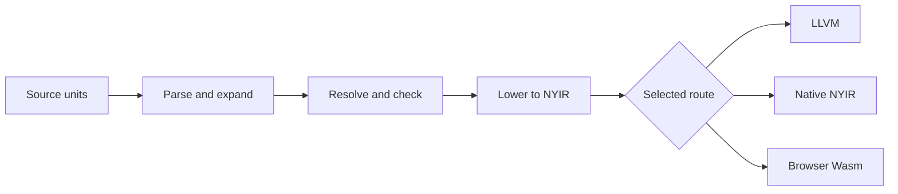

<!-- nytrix-doc: {"audience":"contributor","featured":true,"group":"spec","order":380,"summary":"How checked source reaches NYIR, machine code, LLVM, or WebAssembly."} -->
# Pipeline

The compiler checks source before selecting a code-generation route. Each
backend has its own source-shape and host limits.

> **Note:** Usually unnecessary unless a route differs or you need a compiler stage.

## Contents

- [Stage map and checking](#stage-map)
- [Lowering and execution](#lowering-and-execution)
- [Worked trace](#worked-trace)

## Stage map

1. Parse source units and expand compile-time forms.
2. Resolve names and check language and ownership contracts.
3. Lower checked source into NYIR.
4. Select a backend to execute or emit an artifact.

Source units and the selected standard library pass through parsing, expansion,
symbol resolution, and semantic checking before one shared source-to-NYIR
lowering step. Ownership and provenance analysis run when enabled. The selected
backend then consumes NYIR:



| Route | Code generation |
| --- | --- |
| LLVM | NYIR-to-LLVM emission, then LLVM JIT execution or object emission and linking. |
| Owned native | NYIR optimization, typed machine lowering, register allocation, and native object or JIT emission. |
| Browser/Wasm | Supported Wasm lowering and explicit browser host imports. |

The CLI and REPL share the source-to-NYIR lowerer. The REPL keeps incremental
parsing and semantic preparation, then uses the same NYIR execution backends.

The exact terminal path is selected by the command and backend. `--native-only`
requires the NYIR/native path. On supported hosts, `--run=aot` and `--output` select the
owned native object encoder unless `--native-backend` explicitly chooses
another backend; the browser tools use the Wasm path. Unsupported shapes
diagnose at their owning boundary instead of selecting a different backend
silently.

## Before code generation

Parsing builds the source program after imports and source-unit rules are
known. Compile-time expressions and generated declarations are resolved before
their dependent runtime code is emitted. Type inference, trait/effect facts,
and ABI/layout checks run before code generation. Ownership and provenance
checks are enabled by ownership, borrow, or safe-mode options; they are
separate from ordinary type inference.

### Trait validation

After HM typing, the type pipeline runs trait validation before ABI analysis
(`NY_TYPE_PIPELINE_STAGE_TRAIT` in `src/code/lang/ny/semantics/pipeline/emit.c`).
Failures report `trait validation failed`.

It checks:

- An operator's target function must exist, take two arguments, and match the
  declared parameter and return types. Duplicate `(operator, left, right)`
  declarations in one scope are rejected.
- User code cannot define duplicate attached methods with the same owner,
  method tail name, and arity. Standard-library delegating duplicates are allowed.
- Binary operators on nominal custom types must resolve to exactly one impl;
  unresolved or ambiguous operators produce diagnostics.

Impl law propositions are checked by the shared trait-validation stage with
the proof policy and compile-time Boolean evaluator, before codegen prepare.
Trait definitions enter the codegen trait list; `impl Trait for Type` method
bodies lower like ordinary functions with trait metadata.

User-facing detail: [Traits and impl](traits.md).

Attributes such as `@inline` are requests evaluated by the relevant optimizer.
They do not bypass type, effect, ownership, ABI, or backend-support checks.

Inlining is bounded deterministically. The small NYIR inliner accepts only
straight-line callees with no nested calls. The general inliner rejects direct
self-recursion and runs at most four fixed-point sweeps; after inlining one edge
of a mutually recursive pair, an inserted call back to the current caller is a
self-call and is not expanded. This prevents recursive expansion from depending
on incidental pass order or unbounded code growth.

## Semantic facts and invalidation

Nytrix deliberately keeps facts in three layers instead of treating every
annotation as interchangeable metadata. The source/type layer owns language
meaning; NYIR owns optimizer facts; machine form owns target/ABI facts. A pass
may derive a stronger fact for its own layer, but it must not write that result
back as a source-level guarantee.

After HM/type checking, the structured source type graph is `ny_type_t`
(`src/code/lang/ny/semantics/types.h` / `src/code/lang/ny/semantics/typeinfer.c`). ABI-facing lowering resolves
source type names through `resolve_type_name` / `resolve_abi_type_name` and
caches the resulting carrier types in semantic function/variable records. NYIR
then uses its own typed opcodes and `nyir_type_map_t`; machine lowering consumes
that typed NYIR plus the selected target descriptor. String type names remain a
source/diagnostic boundary, not an optimizer fact format.

| Fact | Primary producer | Main consumers | Invalidated or recomputed when |
| --- | --- | --- | --- |
| semantic type / trait | type inference and semantic checking | call lowering, ABI resolution, specialization | source binding/call shape changes |
| ownership / escape / alias | ownership and function-summary analysis | call optimization, SROA, LICM/vector legality | capture, mutation, unknown/FFI/thread escape changes |
| effects | function-effect analysis and NYIR opcode effects | CSE, DCE, LICM, scheduling | call target or memory/control operation changes |
| range / proof evidence | proof/range analysis, SCEV/IRCE, NYIR analysis | folding, BCE, narrowing, strength reduction | defining value or controlling CFG changes |
| layout / ABI | layout resolver plus target descriptor | call lowering, object emission | target, ABI, or declaration layout changes |
| machine facts | NYIR→machine lowering and regalloc | encoder/object writer | NYIR or target selection changes |

The tooling-only `--emit-artifact` output keeps these source facts in
versioned, pointer-free records. Typed expression facts use
`nytrix.semantic.expression-effects` v1 for the inferred built-in and custom
effect rows of an expression subtree. `inferred_custom_row` contains the
closed custom capability row composed from the call and child rows; it is
null when an open tail or unresolved callback prevents a sound result. The
built-in row remains null when the trusted analysis cannot resolve a child.
Call expressions separately use
`nytrix.semantic.call-effects` v1, which includes resolved signature rows and
callback-contributed effects. A `known: false` record is not a pure row.
Function records also include `nytrix.semantic.statements` v1, containing
source-ordered `nytrix.semantic.statement-effects` v1 entries for supported
statement trees. Unsupported statement kinds are marked unknown; declarations
and control-only statements are explicitly classified as effect-free.
Statement and expression custom rows are composed independently of built-in
mask rows and preserve capability identities from direct calls and known
callback substitutions. These compiler artifacts are
read-only tooling data, not a runtime reflection API or an authority for
optimization.

The NYIR pass manager refreshes instruction metadata after every successful pass
and verification checkpoints reject malformed effects/ranges and broken CFG/SSA
invariants. CFG-changing transforms therefore cannot rely on a range/effect fact
that was merely left attached to an old instruction shape; a pass that needs a
dominator, loop, alias, or range view rebuilds that analysis from the current
function.

Pass statistics retain before/after instruction, SSA-value, and basic-block
counts for each recorded pass, so optimizer growth can be attributed before a
later expensive pass rather than inferred only from the final function size.
Translation validation and verify-each-pass checks are diagnostic modes: they
are disabled unless their command-line controls request them, keeping their
cloning/solver cost off ordinary release compilation.

## Lowering and execution

`src/code/lang/ny/lower/lower.c` and `src/code/lang/c/lower/` own source-to-NYIR lowering.
The CLI, REPL, native backends, LLVM backend, and NYIR VM use this shared
representation; there is no supported AST-to-LLVM execution route.

The LLVM pipeline in `src/code/lang/ny/pipeline/native.c` calls
`nyr_build_ir()` and then `ny_llvm_emit_nyir_module()`. LLVM can optimize the
linked module, execute it through MCJIT or ORC, or emit an object for the host
linker. `-flto` preserves LLVM optimization after parallel module bitcode is
linked.

Owned-native execution also starts from NYIR, then runs the verified
optimization pipeline, lowers to typed machine form, and emits native code.
Native `-flto` selects the aggressive whole-program NYIR pipeline; it is not
LLVM bitcode LTO. The NYIR VM interprets the same lowered functions. The
browser path lowers its supported surface to Wasm with explicit host imports.

`codegen_prepare()` in `src/code/lang/ny/gen/llvm/prepare.c` remains part of compiler
preparation: it collects module, signature, effect, and link information used
by the shared pipeline. The LLVM backend also uses selected helpers from
`src/code/lang/ny/gen/llvm/` for declarations and globals. The older AST-body emitters
(`gen_expr`, `gen_stmt`, and `gen_closure`) are not called by the CLI or REPL
routes; changing them does not change current language behavior. The removed
`--legacy-llvm-dump` option is rejected rather than selecting a second
lowering route.

The defer regression fixtures exercise the live routes with the same source:

| Fixture | Routes | Invariants checked |
| --- | --- | --- |
| `etc/labs/tests/lang/execution/defer.nshape` | `--run=native`, `--native-only`, LLVM MCJIT, LLVM ORC, `--nyr-run-profile` | LIFO scope cleanup, mutable captures, integer and float homes, panic unwinding, and null callbacks |
| `etc/labs/tests/lang/execution/defer-loop-capture.nshape` | Same five routes | Deferred loop reads capture the registration-time value |

These are semantic route checks, not performance comparisons. Keep them
aligned when changing shared lowering or a backend consumer.

## Imports, standard library, and caches

Imports are resolved as source units before ordinary declarations need their
names. The selected standard-library source or bitcode is incorporated into the
program and may use a validated cache. Cache keys include source, compiler and
option identity, selected standard-library inputs, and relevant timestamps.

`--parallel=modules` additionally keeps persistent module bitcode under the
Nytrix cache directory. A module key includes the compiler identity, emission
options, the entry source identity, and the content fingerprints of that
module's transitive source-unit dependencies. An unchanged unit is linked from
that cache; changing a dependency gives its dependents new keys and rebuilds
only their module artifacts. Publication is atomic, so an interrupted worker
cannot be reused. Set `NYTRIX_TRACE_CACHE=1` to see `module cache hit` and
`module cache saved` records. The normal single-module JIT path continues to
use its whole-program cache.

Runtime artifacts are rebuilt by the build driver when their owned runtime
sources change. In particular, a change under `src/code/backend/runtime/` such as
`src/code/backend/runtime/core.c` invalidates the runtime build input; this is build-time
dependency tracking, not a runtime recompilation of a shared library.

## Worked trace

Take a minimal program:

```ny
use core

fn square(int x) int { x * x }

assert_eq(square(21), 441, "square")
```

Compile it through each stage:

```bash
ny --dump-ast hello.ny           # parsed source tree; no execution
ny --dump-ast=typed,filter=square hello.ny  # checked declaration
ny -vvvv hello.ny                # full compiler trace; save failure artifacts
ny --dump-on-error --dump-dir=build/debug/case hello.ny
ny --dump-diagnose --dump-dir=build/debug/case hello.ny
ny --dump=llvm hello.ny          # LLVM IR to stderr
ny --emit=ir=build/trace/hello.ll --run=none hello.ny   # IR to a file
ny --dump=nyr --native-only hello.ny                     # NYR blocks
ny --nyr-track-value=12 --native-only hello.ny           # follow SSA value 12
ny -trace hello.ny               # runtime trace
```

Flags come before the file argument. AST dumps stop before execution; the typed
form first validates types and traits. See [AST inspection](../learn/debugging.md#ast-inspection)
for node metadata and filtering. `--dump=llvm` prints LLVM IR; `--emit=ir=PATH`
writes it to a path and `--run=none` stops before execution. `-vvvv` and
`-vvvvv` enable the deepest compiler trace and save artifacts on failure under
`build/debug/`; `--dump-dir` chooses another location. The failure manifest
records the failing stage and which artifacts were actually written. At
`-vvvvv`, optimizer candidate-decision hooks print without per-pass
`NY_TRACE_*` setup; passes without candidate hooks still report their pass
summary and whether the IR changed. `-vvvvv` keeps imported-library internals
out of the trace; `-vvvvvv` includes them and adds phase timing and resource
summary. A parse
failure saves the input source and removes stale IR from an earlier run.
`--dump-diagnose` writes the input source, pre/post LLVM IR, assembly, bitcode,
statistics, and a summary when compilation succeeds. A failed run refreshes
the source and summary with its exit status; artifacts from an earlier run are
cleared first. On the native path,
`--nyr-dump[=raw,cfg,stats,passes]` selects NYR details;
`--nyr-dump-to=PATH` writes text output to a file.
`--nyr-track-value=N` follows zero-based NYR SSA
value `N` across optimization passes and reports its defining operation and
use count, or that the pass removed it; the option enables those logs itself.
Dump and trace runs bypass compilation caches, so do not use them as
performance evidence.

## Related

- [Units](units.md) - imports, modules, and entry points.
- [Compile-time execution](comptime.md) - evaluation and generated source.
- [Native](native.md) - native ABI and machine-form boundaries.
- [Memory](memory.md) - runtime representation boundaries.
